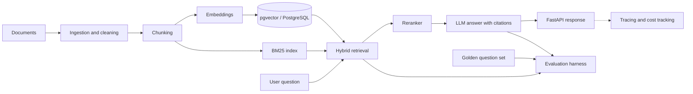

# GroundTruth

**A production-grade RAG pipeline with built-in evaluation and observability.**

GroundTruth answers questions over a corpus of real-world documents, cites the passages behind every answer, and measures its own quality. Each change to the pipeline (chunk size, hybrid search, reranker, prompt) is scored against a golden question set, so improvements are backed by numbers instead of impressions.

> **Status:** in active development. See the [roadmap](#roadmap) for what is done and what is next.

[Live demo](#) · [Architecture](#architecture) · [Evaluation results](#evaluation-results) · [Quickstart](#quickstart)

---

## Why this project

Most RAG demos work on clean text and are never measured. Real systems break on messy documents, weak retrieval, and confident wrong answers. GroundTruth is built to handle those failures:

- **Grounded answers:** every claim links back to a source passage, and the system refuses to answer when retrieval is weak.
- **Measured quality:** retrieval and answer quality are scored on a golden question set, with results tracked after every change.
- **Observable in production:** every request is traced, with latency and cost per query.

## Features

- Ingestion and cleaning of messy PDFs and documents
- Configurable chunking strategies
- Hybrid retrieval: BM25 keyword search plus embedding search, with a reranker
- Answer generation with source citations
- FastAPI service with streaming responses
- Evaluation harness: recall@k, MRR, faithfulness, answer relevance
- Tracing, caching, rate limiting, and cost-per-query tracking
- Dockerized for deployment

## Architecture



## Tech stack

| Layer | Tools |
|---|---|
| Language and API | Python, FastAPI |
| Vector store | PostgreSQL with pgvector |
| Retrieval | BM25 + embeddings, reranker |
| LLM | _fill in: the LLM API you use_ |
| Evaluation | Ragas, custom retrieval metrics |
| Observability | Langfuse |
| Deployment | Docker, _fill in: your host_ |

## Dataset

_Fill in once chosen: what the corpus is, how many documents, where it comes from, and why it is a hard test (for example, scanned tables, inconsistent formatting, long documents)._

## Evaluation results

The golden set contains _N_ questions, each with a known answer and source document. Every row below is one experiment, run on the same question set.

| Experiment | Recall@5 | MRR | Faithfulness | Avg latency | Cost / query |
|---|---|---|---|---|---|
| Baseline (dense search only) | – | – | – | – | – |
| + Hybrid search (BM25 + dense) | – | – | – | – | – |
| + Reranker | – | – | – | – | – |
| + Tuned chunking | – | – | – | – | – |
| + Caching | – | – | – | – | – |

_Replace the dashes with your measured numbers. Only report results you have actually run._

### What worked and what didn't

_Fill in as you go. Examples: which chunk size won, where the reranker helped or hurt, which failure cases remain. This section shows engineering judgment, so be specific and honest._

## Quickstart

```bash
# 1. Clone and install
git clone https://github.com/PV1218/groundtruth.git
cd groundtruth
python -m venv .venv && source .venv/bin/activate
pip install -r requirements.txt

# 2. Configure environment
cp .env.example .env   # add your LLM API key and database URL

# 3. Start PostgreSQL with pgvector, then ingest the documents
docker compose up -d db
python -m ingestion.run --source data/raw

# 4. Run the API
uvicorn api.main:app --reload
```

Ask a question:

```bash
curl -X POST http://localhost:8000/ask \
  -H "Content-Type: application/json" \
  -d '{"question": "Your question here"}'
```

Run the evaluation suite:

```bash
python -m evaluation.run --golden data/golden_questions.json
```

## Project structure

```
groundtruth/
├── data/            # raw documents and golden question set
├── ingestion/       # loading, cleaning, chunking
├── retrieval/       # embeddings, BM25, hybrid search, reranker
├── generation/      # prompts, answer and citation logic
├── evaluation/      # recall@k, MRR, faithfulness, reports
├── api/             # FastAPI service
├── observability/   # tracing, caching, cost tracking
├── tests/
├── Dockerfile
└── README.md
```

## Roadmap

- [ ] Choose the dataset and write the golden question set
- [ ] Baseline pipeline: ingest, chunk, embed, retrieve, answer with citations
- [ ] Evaluation harness with baseline scores
- [ ] Hybrid search and reranker, with measured impact
- [ ] FastAPI service with streaming
- [ ] Tracing, caching, rate limiting, cost tracking
- [ ] Prompt injection and hallucination test cases
- [ ] Docker deployment with a live demo
- [ ] Optional: simple web chat UI with streaming

Tick items off as they ship.

## Author

**Pranav Kanwale** · [LinkedIn](https://linkedin.com/in/pranav-kanwale-879abb279) · [GitHub](https://github.com/PV1218)
